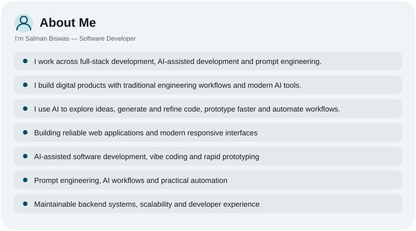
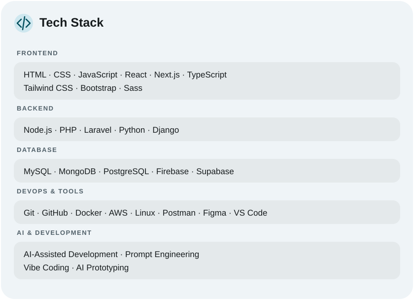
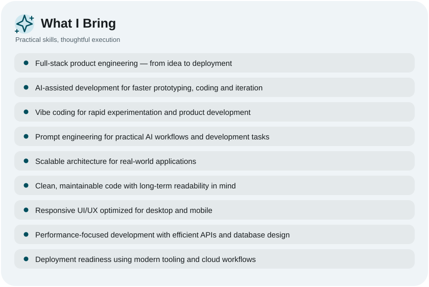
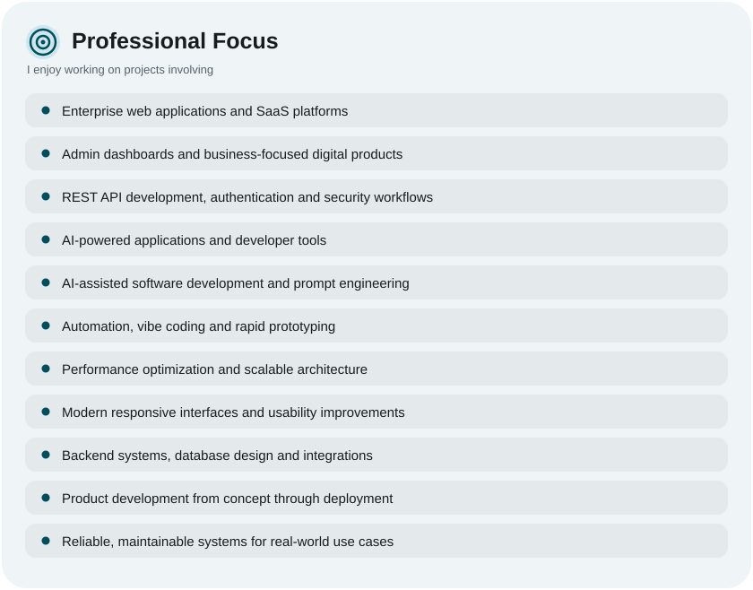
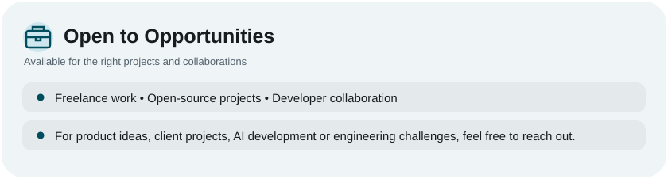
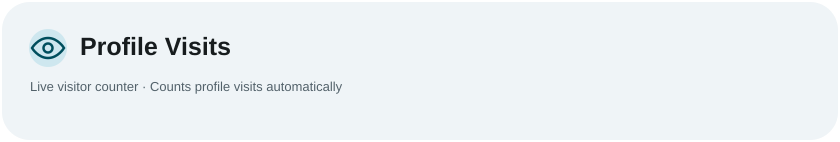

<picture><source media="(prefers-color-scheme: dark)" srcset="assets/hero-dark.svg"></picture>

<a href="https://t.me/ryoaonetsuki"><picture><source media="(prefers-color-scheme: dark)" srcset="assets/social-1-dark.svg"></picture></a>&nbsp;&nbsp;<a href="https://t.me/aonetsukiarchive"><picture><source media="(prefers-color-scheme: dark)" srcset="assets/social-2-dark.svg"></picture></a>

<picture><source media="(prefers-color-scheme: dark)" srcset="./profile-assets/premium-about-dark.svg"></picture>

<picture><source media="(prefers-color-scheme: dark)" srcset="assets/stats-dark.svg"></picture>

<picture><source media="(prefers-color-scheme: dark)" srcset="assets/streak-dark.svg"></picture>

<picture><source media="(prefers-color-scheme: dark)" srcset="./tech-stack-dark.svg"></picture>

<picture><source media="(prefers-color-scheme: dark)" srcset="./profile-assets/premium-bring-dark.svg"></picture>

<picture><source media="(prefers-color-scheme: dark)" srcset="./profile-assets/premium-focus-dark.svg"></picture>

<picture><source media="(prefers-color-scheme: dark)" srcset="./profile-assets/premium-connect-dark.svg"></picture>

<picture><source media="(prefers-color-scheme: dark)" srcset="./profile-assets/premium-opportunities-dark.svg"></picture>

<picture><source media="(prefers-color-scheme: dark)" srcset="./profile-assets/premium-visitor-counter-dark.svg"></picture>

<a href="https://github.com/ryoaonetsuki?tab=repositories"><picture><source media="(prefers-color-scheme: dark)" srcset="./profile-assets/premium-repositories-dark.svg"></picture></a>
&nbsp;&nbsp;
<picture><source media="(prefers-color-scheme: dark)" srcset="./profile-assets/premium-portfolio-dark.svg"></picture>

