

<picture><source media="(prefers-color-scheme: dark)" srcset="assets/hero-dark.svg"></picture>

<picture><source media="(prefers-color-scheme: dark)" srcset="assets/about-dark.svg"></picture>

<!-- premium-custom:quote:start -->
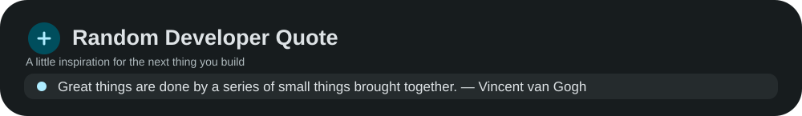
<!-- premium-custom:quote:end -->

<picture><source media="(prefers-color-scheme: dark)" srcset="assets/stats-dark.svg"></picture>

<picture><source media="(prefers-color-scheme: dark)" srcset="assets/streak-dark.svg"></picture>

<picture><source media="(prefers-color-scheme: dark)" srcset="assets/wave-dark.svg"></picture>

<picture><source media="(prefers-color-scheme: dark)" srcset="assets/stack-dark.svg"></picture>

<!-- premium-custom:bring:start -->
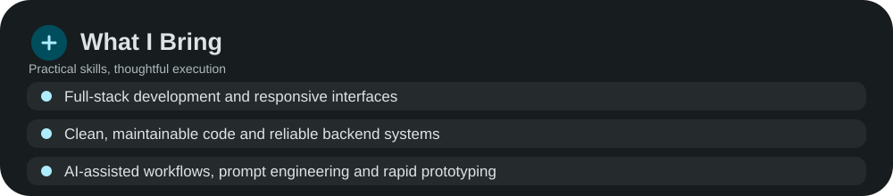
<!-- premium-custom:bring:end -->

<!-- premium-custom:focus:start -->
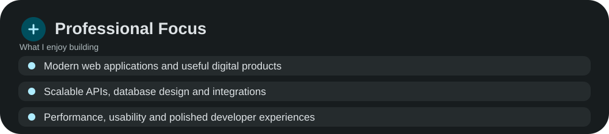
<!-- premium-custom:focus:end -->

<!-- premium-custom:connect:start -->
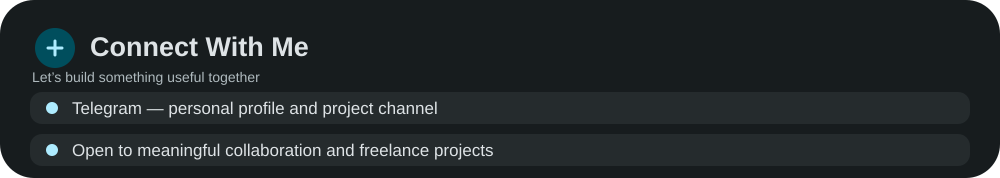
<!-- premium-custom:connect:end -->

<picture><source media="(prefers-color-scheme: dark)" srcset="assets/social-l-dark.svg"></picture><a href="https://t.me/ryoaonetsuki"><picture><source media="(prefers-color-scheme: dark)" srcset="assets/social-1-dark.svg"></picture></a><a href="https://t.me/aonetsukiarchive"><picture><source media="(prefers-color-scheme: dark)" srcset="assets/social-2-dark.svg"></picture></a><picture><source media="(prefers-color-scheme: dark)" srcset="assets/social-r-dark.svg"></picture>

<!-- premium-custom:opportunities:start -->
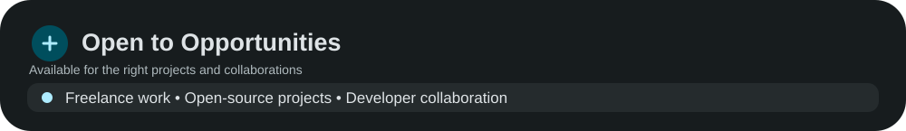
<!-- premium-custom:opportunities:end -->

<a href="https://metawka.github.io/expressive-profile/?from=ryoaonetsuki"><picture><source media="(prefers-color-scheme: dark)" srcset="assets/credit-dark.svg"></picture></a>

<a href="https://github.com/ryoaonetsuki?tab=repositories"><picture><source media="(prefers-color-scheme: dark)" srcset="assets/button-1-dark.svg"></picture></a>

<!-- premium-custom:footer:start -->
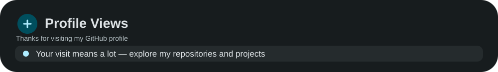

<!-- premium-custom:footer:end -->
