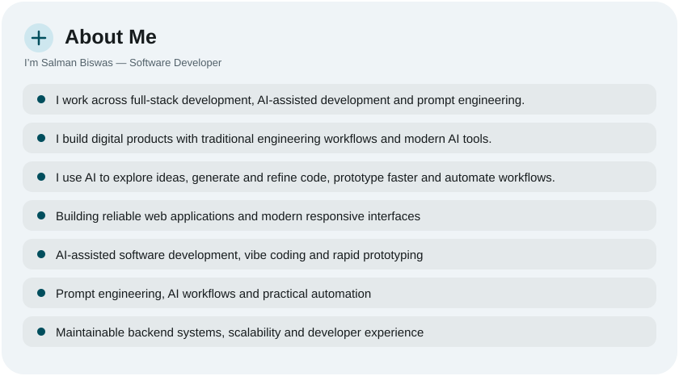
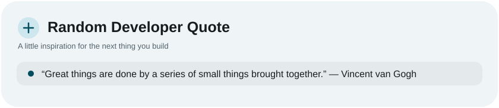
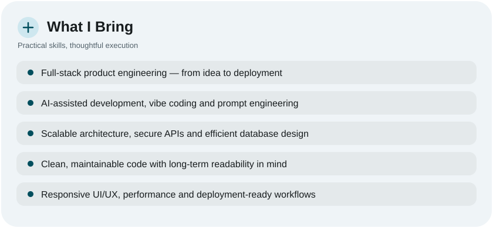
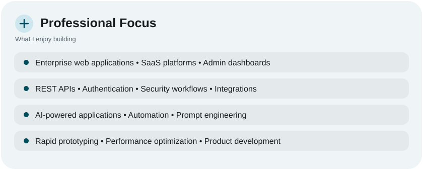
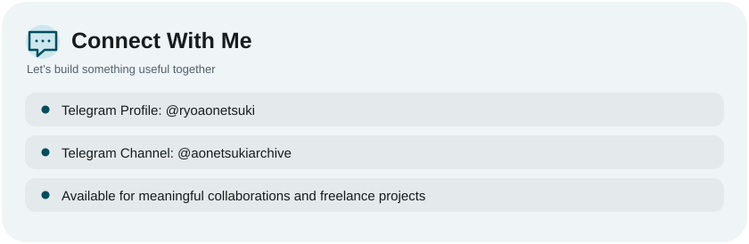
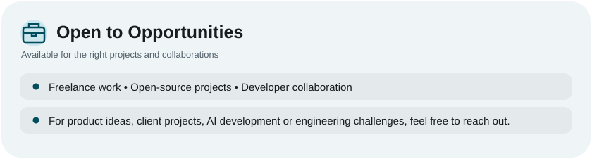
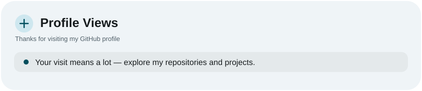

<picture><source media="(prefers-color-scheme: dark)" srcset="assets/hero-dark.svg"></picture>

<picture><source media="(prefers-color-scheme: dark)" srcset="assets/social-l-dark.svg"></picture><a href="https://t.me/ryoaonetsuki"><picture><source media="(prefers-color-scheme: dark)" srcset="assets/social-1-dark.svg"></picture></a><a href="https://t.me/aonetsukiarchive"><picture><source media="(prefers-color-scheme: dark)" srcset="assets/social-2-dark.svg"></picture></a><picture><source media="(prefers-color-scheme: dark)" srcset="assets/social-r-dark.svg"></picture>

<picture><source media="(prefers-color-scheme: dark)" srcset="assets/premium-about-dark.svg"></picture>

<picture><source media="(prefers-color-scheme: dark)" srcset="assets/premium-quote-dark.svg"></picture>

<picture><source media="(prefers-color-scheme: dark)" srcset="assets/stats-dark.svg"></picture>

<picture><source media="(prefers-color-scheme: dark)" srcset="assets/streak-dark.svg"></picture>

<picture><source media="(prefers-color-scheme: dark)" srcset="assets/wave-dark.svg"></picture>

<picture><source media="(prefers-color-scheme: dark)" srcset="assets/premium-stack-dark.svg"></picture>

<picture><source media="(prefers-color-scheme: dark)" srcset="assets/premium-bring-dark.svg"></picture>

<picture><source media="(prefers-color-scheme: dark)" srcset="assets/premium-focus-dark.svg"></picture>

<picture><source media="(prefers-color-scheme: dark)" srcset="assets/premium-connect-dark.svg"></picture>

<picture><source media="(prefers-color-scheme: dark)" srcset="assets/premium-opportunities-dark.svg"></picture>

<picture><source media="(prefers-color-scheme: dark)" srcset="assets/premium-views-dark.svg"></picture>

<picture><source media="(prefers-color-scheme: dark)" srcset="assets/credit-dark.svg"></picture>

<a href="https://github.com/ryoaonetsuki?tab=repositories"><picture><source media="(prefers-color-scheme: dark)" srcset="assets/premium-repositories-dark.svg"></picture></a>
&nbsp;&nbsp;
<a href="https://github.com/ryoaonetsuki"><picture><source media="(prefers-color-scheme: dark)" srcset="assets/premium-portfolio-dark.svg"></picture></a>

